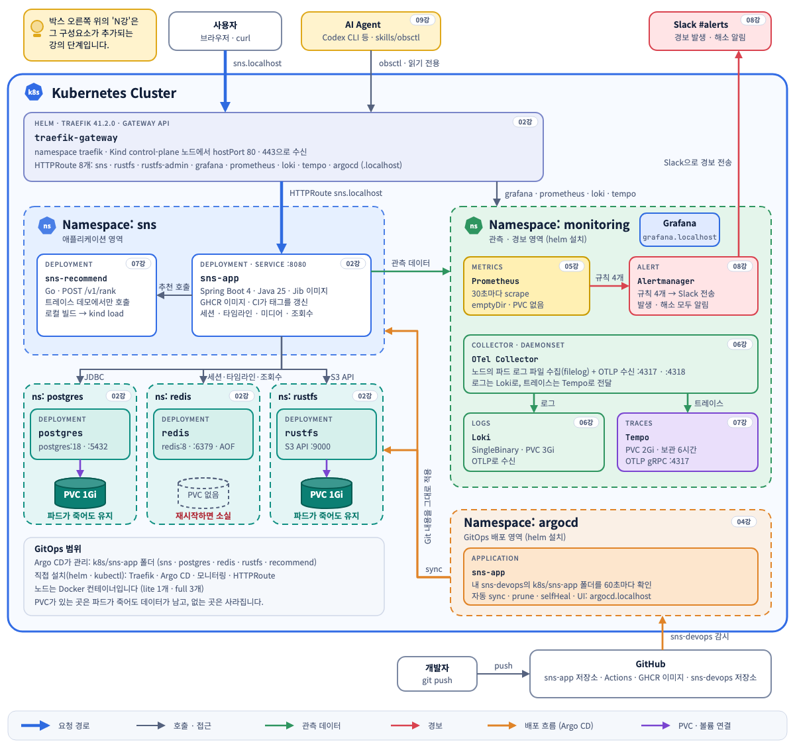
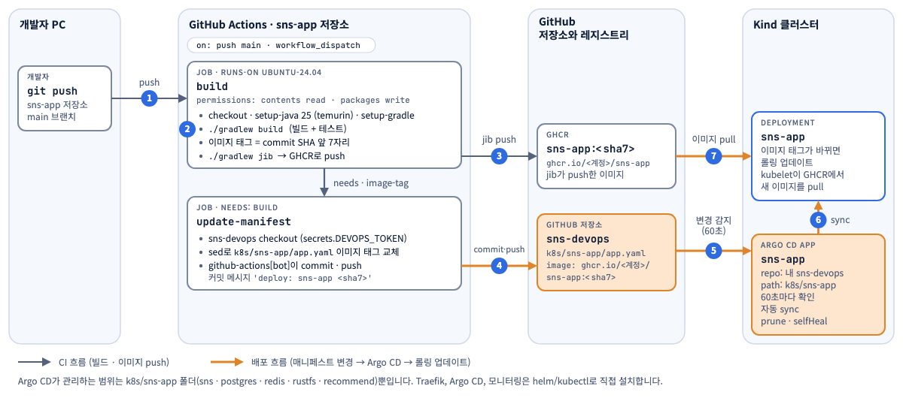
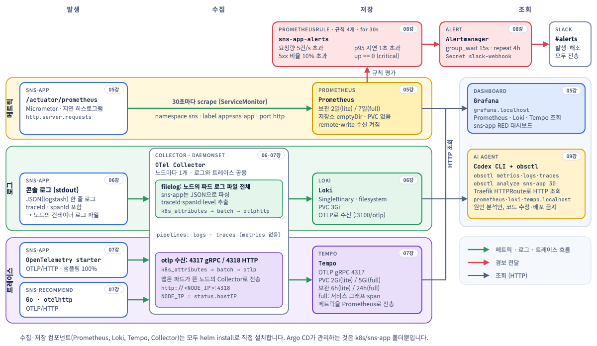
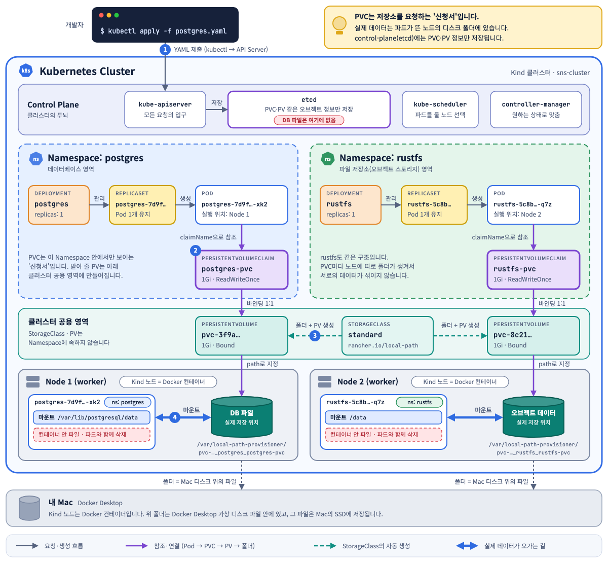
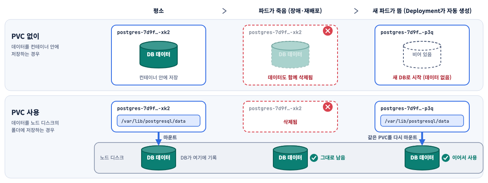

# 아키텍처 다이어그램

강의 9단계까지 마친 sns-app의 구조를 정리한 그림입니다. 그림은 강의 완료본(`part-9`) 기준이라 아직 진행하지 않은 단계의 구성요소도 들어 있습니다.
HTML 파일은 브라우저로 열면 라이트/다크 테마를 따라가고, PNG는 GitHub에서 바로 볼 수 있습니다.

| 파일 | 내용 |
| --- | --- |
| [sns-app-architecture.html](sns-app-architecture.html) | 전체 구조, 배포 흐름, 관측 파이프라인, 기능별 저장소 표 |
| [pvc-structure.html](pvc-structure.html) | PVC가 만들어지는 과정과 데이터가 저장되는 위치 |

## 전체 구조

## 코드가 배포되기까지

## 관측 데이터의 흐름

## PVC 데이터는 어디에 저장될까

